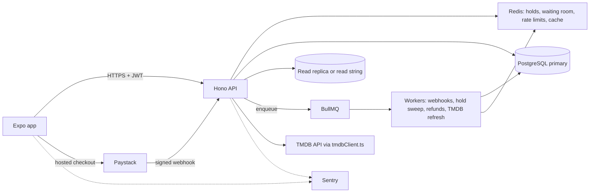

# Matinee PRD

| Field | Value |
|---|---|
| Product | Matinee, a cinema ticket booking app |
| Version | 1.0 (draft) |
| Date | 15 October 2026 |
| Owner | Kate Eze|
| Context | Graduation task, Part 2, Task B (Dev and Design HQ) |
| Deadline | Monday, 19 October 2026 |
| Status | Ready for build |

---

## 1. Summary

Matinee lets people browse films, pick a cinema and showtime, choose seats on a seat map, pay, and get a QR ticket. Film data comes from The Movie Database (TMDB) through our own backend. Cinemas, showtimes, seats, holds, orders, and bookings live in our database.

### 1.1 Why this project exists

This is a hiring-portfolio project. It must prove two things to a remote employer:

1. **Craft:** a polished, accessible, fast interface and a real component library. This is judged harshly.
2. **Correctness under load:** when a popular film opens, thousands of people go for the same seats in the same minute. No seat sells twice and the system stays up.

### 1.2 Success criteria

Matinee is done when all of these are true:

- A user can browse, pick seats, pay (test mode), and see a QR ticket on a real Android development build against the deployed backend.
- The race test (500 users, 50 seats) proves zero double bookings, with saved output and a SQL proof query.
- Every screen was designed in Figma first, and the Figma file and tokens match the code.
- The component gallery shows 12 or more components in every state.
- All deliverables in section 14 exist and are linked from `SUBMISSION.md`.
- The builder can answer every interview question in section 16.

### 1.3 Goals and non-goals

**Goals:** never sell a seat twice; stay up under a surge; excellent UI and motion; accessible; graceful failure; evidence for every claim.

**Non-goals:** real cinema integrations, an admin web app, food ordering, loyalty points, iOS builds, store publishing, real money.

---

## 2. Users

| Role | Who | What they do |
|---|---|---|
| Customer | Anyone booking tickets | Browse, hold seats, pay, view tickets |
| Operator (API only) | Cinema staff (no UI in scope) | Cancel a showtime (triggers refunds), verify a ticket QR. Protected by a server-side operator key |

Customers must be logged in to hold seats. Browsing movies and showtimes works without login.

---

## 3. Scope

**In scope:** movie browsing through a TMDB backend, cinemas and showtimes, seat map, seat holds, waiting room, checkout with Paystack test mode, QR tickets, refunds for cancelled showtimes, ledger, my tickets, dark and light themes, component gallery, accessibility, load test.

**Out of scope:** admin UI, partial refunds, seat transfer, push notifications, multiple currencies in checkout (see stretch).

---

## 4. Assumptions and open questions

Record each assumption as an ADR in `docs/decisions/`. Change values in `server/src/config/` in one place.

| ID | Assumption | Why |
|---|---|---|
| A1 | Currency is NGN. Money is stored in kobo (integers) | Paystack and the local market use naira |
| A2 | Prices: standard 450000 kobo, premium 650000 kobo, wheelchair seats priced as standard | The brief gives no prices |
| A3 | Service fee per order = `max(5000, floor(subtotal * 5 / 100))` kobo, calculated on the server | The brief requires a server-side fee |
| A4 | A seat hold lasts 10 minutes from the first seat selected. Creating an order extends held seats to at least 7 minutes from that moment (payment grace) | Stops a hold expiring while the user is on the payment page |
| A5 | Maximum 8 seats per order | Limits abuse and hoarding |
| A6 | Waiting room: capacity 300 active users per showtime, admission rate 20 users per second, admission lasts 120 seconds and is renewed by a heartbeat every 30 seconds | Values to tune and justify in `TRAFFIC.md` |
| A7 | The waiting room only appears when demand exceeds capacity. Under capacity, users walk straight in | Matches the brief ("when active users exceed a limit") |
| A8 | Seat availability updates by polling every 3 seconds with an ETag (see section 9) | Cheap, resilient, bounded by the waiting room |
| A9 | Login is email and password with rotating refresh tokens, reused from the Rota auth code | Time. No teams, invites, or magic links here |
| A10 | Showtimes have `booking_opens_at`. Before that time the showtime shows "Opens at 10:00" | Lets us demo the surge moment |
| A11 | A paid order whose seats are still free is honoured even if the hold expired. If the seats were taken, the order is refunded automatically | Fair to the customer, safe for the data |
| A12 | TMDB data is cached with the TTLs in section 7.2 and a stale copy is kept for 7 days | Required: serve cached data when TMDB is down |

| ID | Open question | Default |
|---|---|---|
| OQ1 | TMDB's current terms on caching duration and rate limits | Read the terms before coding and record the answer in `ADR-003-tmdb-terms`. Do not rely on memory |
| OQ2 | TMDB licensing: the free API is for non-commercial use. A ticket seller is commercial | Portfolio and test mode are fine. Write in the README that production use needs a commercial TMDB agreement |
| OQ3 | Can the Paystack account run NGN test checkouts and send webhooks to a public URL? | Use the deployed backend URL for the webhook. For local work use a tunnel or a signed local simulator script |
| OQ4 | Redis free tier limits with BullMQ | Check current limits in M0. Fall back to the host's Redis |

---

## 5. Functional requirements

### 5.1 Accounts

| ID | Requirement | Acceptance criteria |
|---|---|---|
| FR-U1 | Sign up, log in, log out, log out of all devices | Argon2id, 15 minute access token, rotating refresh token with reuse detection, tokens in `expo-secure-store`. Same tests as Rota T4 |
| FR-U2 | Password strength guidance on sign up | Same advisory meter and server rules as Rota |

### 5.2 Browse movies (TMDB through the backend)

| ID | Requirement | AC |
|---|---|---|
| FR-M1 | Home: hero carousel, Now showing grid, Coming soon row | Data from `GET /v1/movies/now-playing` and `/upcoming` |
| FR-M2 | Movie detail | Backdrop, poster, title, rating, runtime, genres, synopsis, top cast, "Book tickets" button |
| FR-M3 | Search | Debounced search with recent searches, skeleton and empty states |
| FR-M4 | TMDB attribution | Credits screen shows the required notice and logo (section 7.4) |
| FR-M5 | Degraded mode | If TMDB is down, cached data is shown with a quiet "Showing saved details" note. Booking still works |

### 5.3 Showtimes and cinemas

| ID | Requirement | AC |
|---|---|---|
| FR-S1 | Showtimes for a movie by date | Date strip (next 7 days), cinemas listed with time chips |
| FR-S2 | Showtime chip states | Available, filling fast (under 20 percent seats left), sold out, opens later, cancelled |
| FR-S3 | Booking opens at | Before `booking_opens_at` the screen shows a countdown and no seat access |

### 5.4 Seat selection and holds

| ID | Requirement | AC |
|---|---|---|
| FR-H1 | Seat map shows 300 or more seats | Available, selected, held, sold, wheelchair-accessible, premium states, distinguishable without color |
| FR-H2 | Holding seats is atomic and all or nothing | One Redis Lua step. A user either gets all requested seats or none |
| FR-H3 | Only one user can hold a seat | Race test T1 |
| FR-H4 | Hold lasts 10 minutes with a visible countdown from the server expiry time | Countdown screen, expiry returns the user to the seat map with a clear message |
| FR-H5 | Releasing seats | Deselecting a seat, leaving the screen, or cancelling releases it. Only the holder can release |
| FR-H6 | Near real-time availability | Polling every 3 seconds with ETag and 304 responses |
| FR-H7 | Seat limit | Selecting a 9th seat is blocked with feedback |
| FR-H8 | Database safety net | Unique constraint on `bookings (showtime_id, seat_id)` |

### 5.5 Waiting room and traffic control

| ID | Requirement | AC |
|---|---|---|
| FR-W1 | Waiting room per showtime | When active users reach capacity, new users queue. Admitted at a fixed rate |
| FR-W2 | Queue UI | Shows position, a rough wait, and auto-enters the seat map when admitted |
| FR-W3 | Rate limits | Per user and per IP on hold, checkout, search, and waiting room endpoints |
| FR-W4 | Graceful failure | On 429 or 503 the app shows a clear message and a retry option, never a crash |

### 5.6 Checkout and payment

| ID | Requirement | AC |
|---|---|---|
| FR-P1 | Order summary with price breakdown | Tickets, service fee, total. All computed on the server in kobo |
| FR-P2 | Hosted checkout in test mode | App opens the provider page in the browser. The app never sees secret keys |
| FR-P3 | Idempotency | `Idempotency-Key` required on order creation |
| FR-P4 | Server decides success | A verified webhook, processed in a background job, confirms the booking. Duplicate events ignored |
| FR-P5 | Failure or abandonment | Held seats are released (failed webhook, cancel, or expiry sweep) |
| FR-P6 | Late webhook | Policy A11, tested (T12) |
| FR-P7 | Ledger | Every charge and refund is an append-only row |

### 5.7 Tickets and refunds

| ID | Requirement | AC |
|---|---|---|
| FR-T1 | Ticket screen with QR code | Movie, cinema, screen, time, seats, order number. QR carries a signed token only |
| FR-T2 | My tickets | Upcoming and past, offline readable (cached) |
| FR-T3 | Showtime cancelled | Operator endpoint cancels, a background job refunds every paid order, writes ledger rows, marks tickets cancelled, and the user sees a clear message |
| FR-T4 | Ticket verification | `POST /v1/operator/tickets/verify` returns valid, already used, or invalid |

### 5.8 Settings and polish

| ID | Requirement | AC |
|---|---|---|
| FR-X1 | Theme setting | System, light, dark. Both themes are designed |
| FR-X2 | Component gallery | Hidden route listing every component in every state (`/gallery`) |
| FR-X3 | Haptics | Seat selection, limit reached, payment success |
| FR-X4 | Motion | Reanimated: screen transitions, seat selection, booking confirmation. Honors "reduce motion" |

---

## 6. Pricing rules

```
subtotal   = sum of seat prices in kobo (standard 450000, premium 650000, wheelchair 450000)
serviceFee = max(5000, floor(subtotal * 5 / 100))
total      = subtotal + serviceFee
```

| Example | Subtotal | Fee | Total |
|---|---|---|---|
| 1 standard seat | 450000 | 22500 | 472500 |
| 2 standard seats | 900000 | 45000 | 945000 |
| 1 standard + 1 premium | 1100000 | 55000 | 1155000 |
| 1 seat with a hypothetical 50000 price | 50000 | 5000 (minimum) | 55000 |

The client never sends prices. It sends seat ids. The server reads prices from the showtime and calculates everything.

---

## 7. TMDB integration (backend for frontend)

### 7.1 Rules

1. The app never calls TMDB. All calls go through our backend, so the key stays secret and we control caching, limits, and failures.
2. **Exactly one file knows TMDB's data shape:** `server/src/integrations/tmdb/tmdbClient.ts`. It validates responses with Zod, maps them into our own types (`Movie`, `MovieDetail`, `CastMember`), and builds image URLs. Everything else in the backend and the app uses only our types.
3. Authenticate with the TMDB API read access token in a header, from an environment variable. Never in the app.

### 7.2 Caching (Redis, cache-aside with stale copy)

| Data | Fresh TTL | Stale copy kept | Why |
|---|---|---|---|
| Now playing list | 6 hours | 7 days | Changes about daily |
| Upcoming list | 12 hours | 7 days | Changes slowly |
| Movie detail (with credits) | 24 hours | 7 days | Rarely changes |
| Search results | 10 minutes | none | Cheap to repeat, many unique queries |
| Image configuration and genres | 24 hours | 7 days | Almost static |

Last-resort fallback: a `movie_snapshots` table holds the last mapped data for every movie that has showtimes, so booking works even if Redis and TMDB are both down.

### 7.3 Failure handling

- **Retry:** up to 3 attempts with exponential backoff and jitter (about 300 ms, 900 ms). Honor `Retry-After` on 429.
- **Circuit breaker:** after 5 consecutive failures, stop calling TMDB for 30 seconds, serve stale data, then try one request.
- **Single flight:** one refresh per key at a time (Redis lock), so a cold cache does not send 5,000 calls.
- **Stale response:** the API includes `"stale": true` so the app can show a quiet note.

### 7.4 Terms and attribution (self-study, do before coding)

Read TMDB's current terms and FAQ. Record in `ADR-003`: the exact attribution wording, the logo rules, caching limits, rate limits, and commercial-use rules. From the TMDB FAQ at scaffold time: show their notice ("This product uses the TMDB API but is not endorsed or certified by TMDB"), use their approved logo, and place both in an About or Credits section with the logo less prominent than your own. Check the live text before shipping because it can change.

---

## 8. Seat holds and booking integrity

### 8.1 State machine

```
available -> held (Redis, 10 min) -> order pending -> paid -> booked (DB row, sold)
                |                         |
                +-- expires / released    +-- failed or abandoned -> released
booked seats are added to the sold set in Redis and exist forever as bookings rows
```

### 8.2 Redis keys (one hash tag per showtime so scripts can touch them together)

| Key | Type | Purpose |
|---|---|---|
| `hold:{st}:<seatId>` | string, value = holdId, TTL = hold time | The lock for one seat |
| `holdidx:{st}` | sorted set, score = expiry ms | Lists live holds for the seat map |
| `sold:{st}` | set | Sold seats (rebuilt from `bookings` when missing) |
| `ver:{st}` | integer | Bumped on every change, used as the ETag |
| `holdsession:{st}:{userId}` | hash | holdId, expiresAt, seat list for this user |
| `wr:queue:{st}`, `wr:active:{st}`, `wr:seq:{st}` | sorted sets and counter | Waiting room |

### 8.3 The atomic hold

Reference code is in `server/src/seats/` and is tested (`server/test/seats.race.test.ts`). The Lua script checks every requested seat (sold set and existing holds), then sets them all, or changes nothing. For a single seat this is exactly `SET key value NX PX ttl`. The script generalises it to several seats at once so a user never ends up with half an order.

### 8.4 The database safety net

`bookings` has `UNIQUE (showtime_id, seat_id)`. Even if the Redis logic had a bug, Postgres refuses a second row for the same seat. Test T5 fires 500 concurrent inserts at 50 seats and exactly 50 succeed.

### 8.5 Redis down (degraded mode)

Correctness never depends on Redis. When Redis fails:

1. A circuit breaker opens.
2. Holds use `holdSeatsInDb` (conditional upsert on `seat_holds`, tested in T6).
3. A per-instance concurrency limit (about 20 concurrent hold transactions) sheds extra load with 503 and `Retry-After`.
4. The waiting room cannot admit through Redis, so new entrants get a calm "very busy, try again" message.
5. Seat availability is read from the database (slower, cached in memory for 2 seconds).
6. Bookings stay correct. Throughput drops. This is the honest answer to interview question 2.

---

## 9. Real-time seat availability

**Decision: polling every 3 seconds with `ETag` and `If-None-Match`.**

| Option | Cost | Verdict |
|---|---|---|
| Polling (3 s, ETag, 304) | Tiny requests. 300 active users make about 100 requests per second of 304s. Works through any proxy and survives reconnects | **Chosen** |
| Server-Sent Events | One open connection per user (300 per showtime). Efficient fan-out via Redis pub/sub, but long connections stress free hosts and need reconnect logic | Upgrade path |
| WebSockets | Two-way, but heavier to run, scale, and secure. Not needed because the client only listens | Rejected |

Why polling is safe here: the waiting room caps active users per showtime, so the polling load is bounded. The endpoint reads one Redis version number and returns 304 when nothing changed.

---

## 10. Payments

### 10.1 Flow

1. `PUT /showtimes/:id/hold` holds seats (user is admitted, rate limited).
2. `POST /orders` with `Idempotency-Key`: server verifies the hold, recomputes prices, creates `orders` and `payment_attempts`, extends the hold (A4), starts a Paystack checkout, returns `checkoutUrl`.
3. App opens the hosted checkout. On return it shows "Confirming payment" and polls `GET /orders/:id`.
4. `POST /webhooks/paystack`: verify signature on the raw body, insert event id (unique), enqueue job, return 200.
5. Webhook job (idempotent, one transaction):
   - Verify amount and currency against `payment_attempts`.
   - Insert `bookings` rows (`ON CONFLICT DO NOTHING`).
   - All inserted: order `paid`, ledger charge row, add seats to `sold:{st}`, delete holds, enqueue confirmation.
   - Any seat already booked: roll back, order `paid_unfulfilled`, enqueue full refund job (ledger refund row), tell the user.
6. Failed payment webhook, cancel, or expiry sweep: release holds, order `failed` or `expired`.

### 10.2 Late webhook (interview question 5)

The webhook can arrive after the hold expired. The job does not care about the hold. It tries to insert the bookings. If the seats are still free, the customer gets them (A11). If someone else booked them, the unique constraint makes the insert fail and the job refunds in full automatically.

### 10.3 Refunds for cancelled showtimes

Operator calls `POST /operator/showtimes/:id/cancel`. A background job finds every `paid` order for the showtime, creates a refund through the provider (idempotent per order), writes a ledger refund row, marks bookings `cancelled`, and notifies the customer. Running it twice does nothing extra.

### 10.4 Ledger and ticket codes

`ledger_entries` is append-only (database trigger blocks UPDATE and DELETE). Types: `charge`, `refund`, `adjustment`. Ticket QR token: `HMAC-SHA256(ticketId + showtimeId + seatId, SERVER_SECRET)` plus the ticket id, verified by the operator endpoint. No personal data in the QR.

---

## 11. Non-functional requirements

| Area | Requirement |
|---|---|
| Correctness | Zero double bookings in the race test and the load test |
| Performance targets | Hold endpoint p95 under 150 ms at 500 virtual users (Redis path). Availability 304 p95 under 50 ms. Movie list p95 under 100 ms cached |
| Availability | A TMDB outage, a Redis outage, or a payment provider delay degrades features but never loses or duplicates a booking |
| Security | Server enforces everything. Secrets only on the server. Zod on every request. Signed QR tokens. Rate limits |
| Observability | Request id on every log line and in jobs. Hold attempts logged with outcome. Sentry on app and server |
| Accessibility | 4.5 to 1 text contrast, labels on every control and image, text scales, 44 point targets, a list-based seat picker for screen readers |
| Images | Progressive loading with placeholders and caching |

---

## 12. System design summary

### 12.1 Stack

| Layer | Choice |
|---|---|
| Mobile | React Native, Expo (dev build via EAS), Expo Router, TypeScript |
| Animation and gestures | Reanimated, Gesture Handler |
| Data | TanStack Query, FlashList, expo-image, expo-haptics |
| Own component library | Built from tokens (not a UI kit). See `docs/DESIGN.md` |
| Backend | Node.js, Hono, Zod, Prisma plus raw SQL |
| Database | PostgreSQL (pooled), Redis, BullMQ |
| Payments | Paystack (or Flutterwave) test mode |
| Errors, load | Sentry, k6 |

### 12.2 Architecture



### 12.3 Data model (key columns and indexes)

| Table | Key columns | Indexes and constraints |
|---|---|---|
| users, refresh_tokens | as in Rota | as in Rota |
| movie_snapshots | tmdb_id pk, data jsonb, fetched_at | |
| cinemas | id, name, city, address | |
| screens | id, cinema_id, name, rows, seat_count | |
| seats | id, screen_id, row_label, number, col_index, kind | unique(screen_id, row_label, number) |
| showtimes | id, movie_tmdb_id, screen_id, starts_at, booking_opens_at, status, price_standard_kobo, price_premium_kobo | index(movie_tmdb_id, starts_at), index(screen_id, starts_at) |
| seat_holds (fallback) | showtime_id, seat_id, hold_id, expires_at | primary key(showtime_id, seat_id) |
| orders | id, user_id, showtime_id, status, subtotal_kobo, fee_kobo, total_kobo, currency, hold_id, hold_expires_at, idempotency_key | unique(idempotency_key), index(user_id, created_at desc), index(status, hold_expires_at) for the sweeper |
| order_seats | order_id, seat_id, price_kobo | primary key(order_id, seat_id) |
| bookings | id, showtime_id, seat_id, order_id, user_id, status, ticket_code | **unique(showtime_id, seat_id)**, index(user_id, created_at desc) |
| payment_attempts | id, order_id, provider_ref, amount_kobo, status | unique(provider_ref) |
| webhook_events | provider, event_id, payload, status | unique(provider, event_id) |
| ledger_entries | id, order_id, type, amount_kobo, currency, provider_ref, idempotency_key | unique(idempotency_key), trigger blocks UPDATE and DELETE |
| idempotency_keys | user_id, key, request_hash, response | primary key(user_id, key) |

### 12.4 Connection pooling and read routing

- API process pool max 10, worker pool max 5. Provider pooled connection string. Reasoning goes in `ADR-007` (provider connection limit divided by processes, with headroom).
- Browse queries (showtimes, cinemas) read from the replica or read string. After a write (order created, payment confirmed), the same user reads from the primary for 5 seconds (`recent_write:{userId}` in Redis). If Redis is down, read from the primary.
- Seat availability does not touch Postgres. It reads Redis.

### 12.5 Sharding plan (documented, not simulated)

See `docs/SHARDING.md` (written from the `sharding-pooling-replication-plan` skill). Summary: shard the transactional tables (bookings, orders, order_seats, payment_attempts, webhook_events, ledger_entries) by `showtime_id`, so the unique constraint stays on one shard. Reference tables stay unsharded. The hot shard risk is one blockbuster showtime. Mitigation: Redis absorbs hold traffic, so the database only sees confirmed bookings; virtual shards let a hot showtime move; a dedicated shard is provisioned for known release days.

### 12.6 Background jobs

| Queue | Jobs |
|---|---|
| webhooks | process-webhook |
| holds | sweep-expired-orders (every 30 s), release-on-failure |
| refunds | refund-order, cancel-showtime-refunds |
| tmdb | refresh-now-playing, refresh-movie |
| email (optional) | booking confirmation |

All jobs retry with exponential backoff (5 attempts) and then stay in the failed list. All are idempotent.

---

## 13. API surface (v1)

| Method | Path | Notes |
|---|---|---|
| POST | /auth/register, /auth/login, /auth/refresh, /auth/logout, /auth/logout-all | reused from Rota, rate limited |
| GET | /movies/now-playing, /movies/upcoming | cached TMDB, includes `stale` flag |
| GET | /movies/search?q= | rate limited, cached 10 min |
| GET | /movies/:tmdbId | detail with cast |
| GET | /movies/:tmdbId/showtimes?date=&city= | grouped by cinema |
| GET | /showtimes/:id | price, status, opens at, seat counts |
| GET | /showtimes/:id/seatmap | static layout, cached 1 hour |
| GET | /showtimes/:id/availability | held and sold seat ids, `ETag`, 304 |
| POST | /showtimes/:id/waiting-room/join | returns ACTIVE or QUEUED with position |
| GET | /showtimes/:id/waiting-room/status | poll every 2 s while queued |
| PUT | /showtimes/:id/hold | body `{ seatIds }` replaces the user's selection, atomic |
| DELETE | /showtimes/:id/hold | release |
| POST | /orders | needs `Idempotency-Key`, returns `checkoutUrl` |
| GET | /orders/:id | status for the confirming screen |
| GET | /tickets, /tickets/:bookingId | my tickets, QR token |
| POST | /webhooks/paystack | raw body, signature check |
| POST | /operator/showtimes/:id/cancel | operator key |
| POST | /operator/tickets/verify | operator key |
| GET | /health | root path, not under /v1 |

Errors use one shape: `{ "error": { "code", "message", "requestId", "fields"? } }`. Matinee error codes and copy: `app/src/ui/errorMessages.ts`.

---

## 14. Deliverables checklist

- [ ] Public GitHub repo (monorepo `matinee`: `/app`, `/server`, `/docs`, `/load-tests`)
- [ ] Android development build download link and deployed backend URL
- [ ] Figma file with design tokens and all screens
- [ ] README (top: description, GIF, download link, demo link; includes the app store billing note and `EXPO_PUBLIC_` list)
- [ ] ARCHITECTURE.md, TRAFFIC.md, SHARDING.md, COMPONENTS.md, LEARNING-LOG.md
- [ ] Notes on 5 apps you admire (screenshots and one line each) in `docs/DESIGN.md`
- [ ] Load test scripts and report (500 virtual users, same 50 seats, zero double bookings proven)
- [ ] Log write-up of what happened during the load test
- [ ] 3-minute demo video: UI, seat map, a booking, load test result
- [ ] LinkedIn post about the double-booking problem
- [ ] ADRs in `docs/decisions/`

---

## 15. Proof tests

Reference code already exists and passes for T1 to T8 (see `server/test/`). Save output in `docs/test-results/`.

| ID | Test | Proves |
|---|---|---|
| T1 | 500 users race for 50 seats, exactly 50 winners, no seat with two holders | Atomic holds |
| T2 | Multi-seat holds are all or nothing | No partial orders |
| T3 | Hold expires and the seat can be taken | Expiry |
| T4 | Only the holder can release | Ownership |
| T5 | 500 concurrent inserts at 50 seats create exactly 50 booking rows | Database safety net |
| T6 | Database fallback holds: exactly 50 of 300 win | Redis outage path |
| T7 | Waiting room: capacity never exceeded, fixed admission rate, first come first served | Traffic control |
| T8 | Rate limiter blocks after the limit and resets | Rate limiting |
| T9 | Bad webhook signature gets 401. Same event three times creates one booking and one ledger row | Webhook safety |
| T10 | Same `Idempotency-Key` returns the stored response and creates one order | Idempotency |
| T11 | Price and fee unit tests (section 6 table, 8 or more cases) | Money math |
| T12 | Late webhook: seats free means booked, seats taken means automatic refund | Late payment policy |
| T13 | Failed or abandoned payment releases the held seats | Seat release |
| T14 | Cancelled showtime refunds every paid order once, ledger rows written | Refunds |
| T15 | TMDB mapping survives a renamed field. TMDB down serves stale data. Retry and circuit breaker work | BFF resilience |
| T16 | Redis stopped: holds still work through the database and no double booking occurs | Degraded mode |
| T17 | Ledger UPDATE and DELETE fail | Append-only ledger |
| T18 | Availability endpoint returns 304 when nothing changed | Cheap polling |

**Load test L1 (k6):** 500 virtual users each try to hold one of the same 50 seats at the same moment. The winners complete orders through a signed webhook simulator. Proof query after the run:

```sql
SELECT showtime_id, seat_id, count(*) FROM bookings GROUP BY 1, 2 HAVING count(*) > 1;  -- must return 0 rows
SELECT count(*) FROM bookings WHERE showtime_id = '<id>';                                -- must be 50 or fewer
```

---

## 16. Interview question map

| Question | Where the answer lives |
|---|---|
| Two users tap the same seat at the same millisecond | Section 8.3, T1, `seat-holds-and-booking-integrity` skill |
| Redis goes down during a surge | Section 8.5, T6, T16 |
| Why call our backend and not TMDB | Section 7.1 |
| TMDB is down. What does the user see? | Section 7.3, FR-M5 |
| Webhook arrives 20 minutes late, after the hold expired | Section 10.2, T12 |
| Show me where tokens are and change a color | `app/src/ui/tokens.ts`, `docs/DESIGN.md` |
| Why polling, WebSockets, or SSE? | Section 9 |
| What did the load test reveal that you did not expect? | `load-tests/REPORT.md` (write it from real results) |

---

## 17. Delivery plan

Build a thin slice first. If time runs short, cut polish before proof tests.

| Milestone | Scope | Exit criteria | Time box |
|---|---|---|---|
| M0 Setup | Monorepo, Docker Postgres and Redis, `/health`, Figma tokens started | `/health` works | 2 h |
| M1 Data and auth | Schema, seed (2 cinemas, 3 screens of 320 seats, showtimes), auth reused from Rota | Login works. Seed prints counts | 4 h |
| M2 TMDB BFF | `tmdbClient.ts`, caching, stale mode, endpoints | T15 passes | 4 h |
| M3 Holds and waiting room | Hold endpoints, availability ETag, waiting room, rate limits, copy the tested code in | T1 to T8, T18 pass | 5 h |
| M4 Payments | Orders, Paystack, webhook job, ledger, late webhook, sweeper, refunds | T9 to T14, T17 pass | 8 h |
| M5 Design system | Tokens in Figma and code, 12+ components, gallery | Gallery shows all states | 8 h |
| M6 Screens | Home, detail, showtimes, seat map, checkout, ticket, my tickets | Full booking on a device | 10 h |
| M7 Polish | Animations, haptics, skeletons, dark mode, accessibility, list seat picker | Accessibility checklist done | 6 h |
| M8 Load and ship | k6, report, log write-up, deploy, EAS build, docs, video, post | All section 14 items linked | 8 h |

**Cut order if short on time:** hero carousel animation, search history, past tickets screen polish, TMDB refresh jobs. Never cut T1 to T8, T12, or the load test.

---

## 18. Risks

| Risk | Mitigation |
|---|---|
| Time: this plus other parts due together | Thin slice, tell facilitators early, reuse Rota auth and patterns |
| Paystack NGN test checkout or webhook setup problems | Use a signed webhook simulator script so the flow is provable even if the provider is slow |
| Seat map janky on mid phones | Memoized seats (done), measure on a real device, Skia is the fallback optimisation |
| 44 point touch targets conflict with 300 small seats | Zoom, hit slop, double tap zoom, and a list-based picker (see design doc) |
| Redis free tier limits | Check in M0, use host Redis if needed |
| Load test on free hosting is misleading | Run locally or on staging and say so in the report |
| TMDB terms or limits changed | Read them in M2 and record in ADR-003 |

---

## Appendix A: Environment variables

**Server only:** `DATABASE_URL`, `DATABASE_URL_READ`, `REDIS_URL`, `JWT_ACCESS_SECRET`, `REFRESH_TOKEN_PEPPER`, `TICKET_SIGNING_SECRET`, `OPERATOR_API_KEY`, `TMDB_READ_ACCESS_TOKEN`, `PAYSTACK_SECRET_KEY`, `SENTRY_DSN_SERVER`, `APP_BASE_URL`, `NODE_ENV`, `LOADTEST_MODE`.

**App (`EXPO_PUBLIC_`, readable by anyone):**

| Variable | Why it is safe |
|---|---|
| `EXPO_PUBLIC_API_URL` | Public address of our API |
| `EXPO_PUBLIC_SENTRY_DSN_APP` | A DSN can only send events |
| `EXPO_PUBLIC_EAS_PROJECT_ID` | An identifier, not a credential |

The TMDB token and the Paystack secret key never appear in the app.

## Appendix B: Hold and waiting room parameters (tune and justify in TRAFFIC.md)

| Parameter | Start value |
|---|---|
| Hold duration | 10 minutes |
| Payment grace extension | at least 7 minutes from order creation |
| Max seats per order | 8 |
| Waiting room capacity | 300 active users per showtime |
| Admission rate | 20 users per second (one tick per second) |
| Admission lifetime | 120 seconds, heartbeat every 30 seconds |
| Availability poll | every 3 seconds |
| Waiting room status poll | every 2 seconds |
| Rate limits (per user, per minute) | hold 20, checkout 5, search 30, waiting room join 10 |
| Rate limits (per IP, per minute) | hold 120, checkout 30, search 120 |
