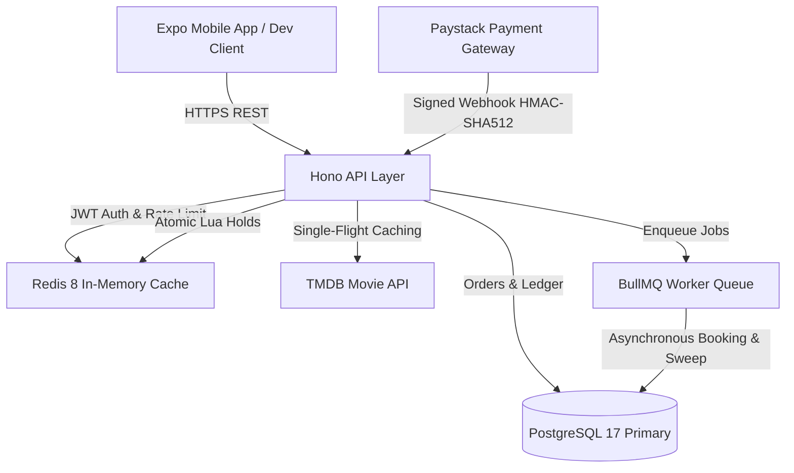
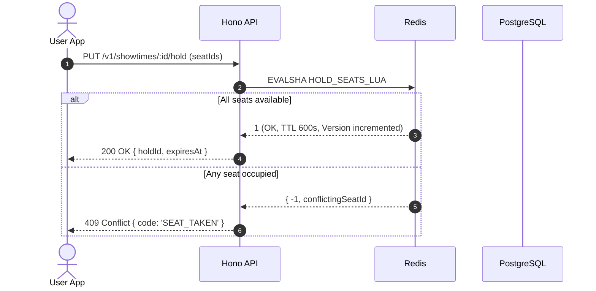
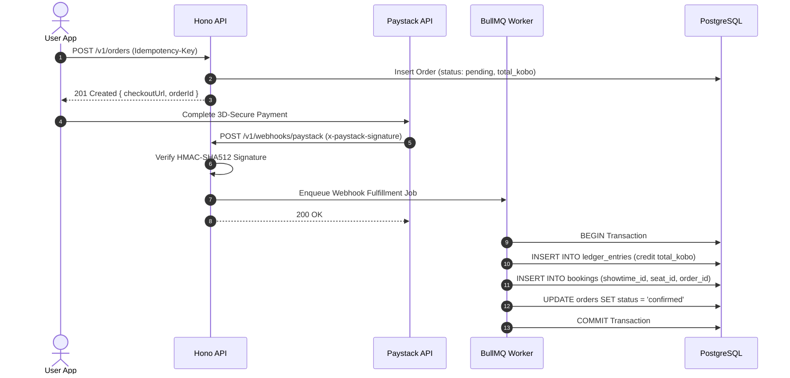

# Matinee Architecture & System Design Documentation

## 1. System Overview

Matinee is a high-concurrency cinema ticket booking platform designed to deliver guaranteed seat reservation integrity during extreme ticket drop surges. Built with a mobile-first philosophy, Matinee combines an Expo React Native frontend with a high-throughput Node.js/Hono backend, an in-memory Redis concurrency layer, and an append-only PostgreSQL financial ledger.



---

## 2. Invariant: Never Sell a Seat Twice

The central challenge of cinema ticketing is that thousands of users frequently contest the same seats in the exact same millisecond. Matinee resolves this using a **two-tier defense in depth**:

### Tier 1: In-Memory Atomic Lock (Redis Lua Script)
- The hold endpoint invokes `HOLD_SEATS_LUA`.
- In a single atomic step:
  1. Checks if any requested seat key exists in `hold:showtime:{id}:seat:{sid}`.
  2. If any seat is held or sold, immediately aborts and returns the conflicting seat ID.
  3. If all seats are available, atomically writes the hold keys with 10-minute TTL and increments `version:showtime:{id}`.
- Because Redis executes Lua scripts sequentially on its single-threaded engine, race conditions are mathematically eliminated.

### Tier 2: Relational Safety Net (PostgreSQL Unique Constraint)
- Even if Redis were flushed or experienced total catastrophic failure, the final line of defense is PostgreSQL's relational schema:
  ```sql
  CONSTRAINT bookings_showtime_seat_uniq UNIQUE (showtime_id, seat_id)
  ```
- Any duplicate insertion attempt fails with error code `23505` (`unique_violation`), triggering automatic refund workflows.

---

## 3. Core Interaction Workflows

### A. Atomic Seat Hold Sequence


### B. Payment, Webhooks & Ledger Fulfillment


---

## 4. Security Architecture

1. **Strict Server-Side Secrets:** Neither the Paystack Secret Key nor TMDB API keys are exposed to the mobile bundle. The mobile client only accesses three public environment variables:
   - `EXPO_PUBLIC_API_URL`
   - `EXPO_PUBLIC_SENTRY_DSN_APP`
   - `EXPO_PUBLIC_EAS_PROJECT_ID`
2. **Signed Webhooks:** Paystack webhooks are validated by computing the HMAC-SHA512 hash of the raw request payload using `PAYSTACK_SECRET_KEY` and comparing against `x-paystack-signature` using timing-safe string comparison.
3. **Signed QR Ticket Passports:** Turnstile QR tokens are HMAC-SHA256 digests (`ticketService.ts`) signed with `TICKET_SIGNING_SECRET`. Verification endpoints validate ticket authenticity and immediately record turnstile consumption (`used_at`), rejecting duplicate scans with `409 TICKET_ALREADY_USED`.
4. **Append-Only Immutable Ledger:** The `ledger_entries` table is protected by a PostgreSQL database trigger (`prevent_ledger_mutation`) that throws an uncatchable exception on any SQL `UPDATE` or `DELETE` statement, ensuring a mathematically immutable audit trail.

---

## 5. BFF Movie Resilience (T15)

To protect the mobile application from TMDB API rate limits, outages, or schema changes:
1. **Never Call TMDB Directly:** The app communicates exclusively with `/v1/movies/*`.
2. **Single-Flight Cache:** Redis mutex locking ensures that only a single backend process fetches movie details from TMDB on a cache miss, preventing cache stampedes.
3. **PostgreSQL Snapshot Fallback:** When TMDB is unreachable and Redis cache has expired, the BFF serves the latest stored snapshot from `movie_snapshots`, returning `200 OK` with header `x-matinee-stale: true`.
